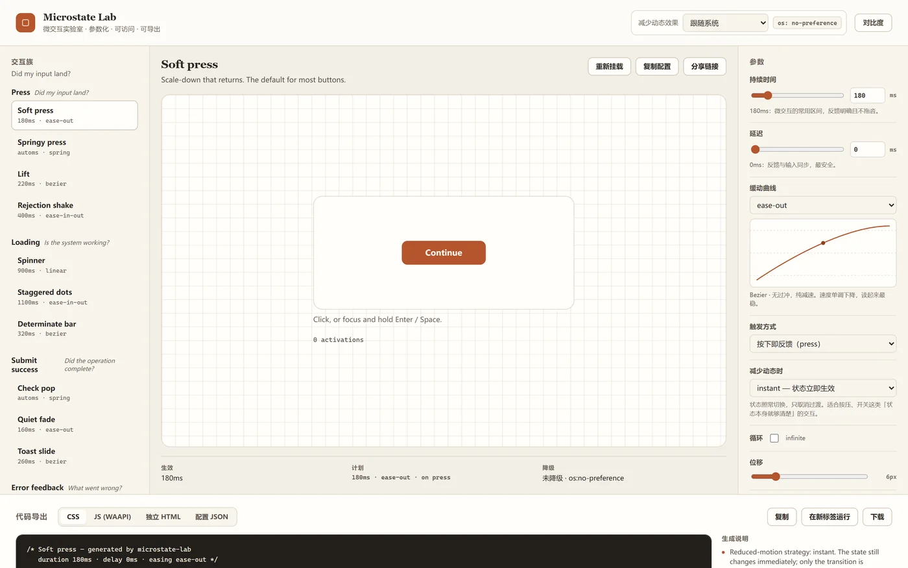
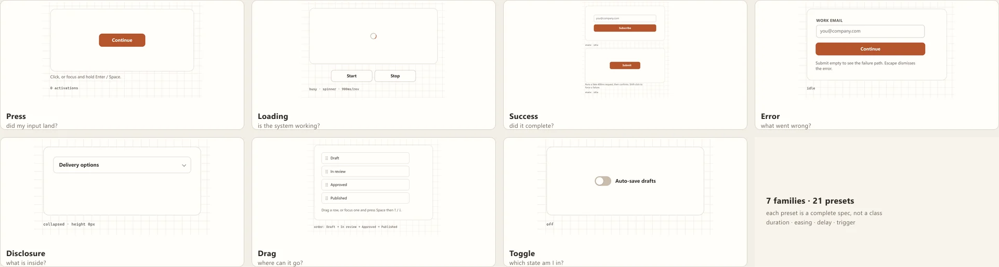
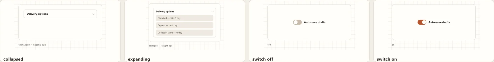
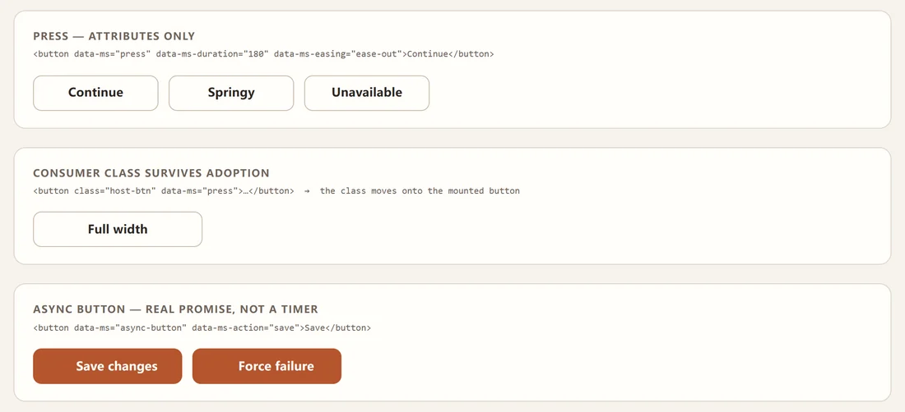
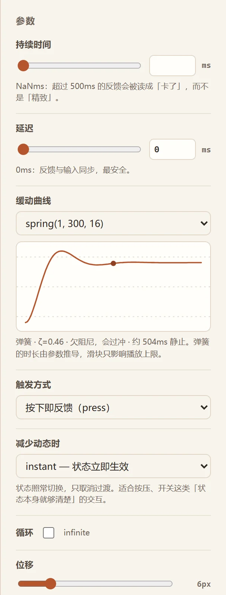
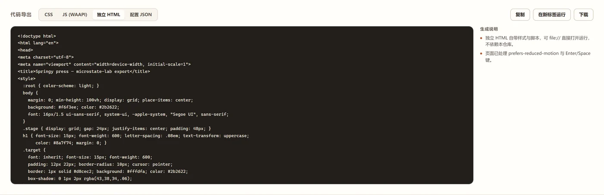
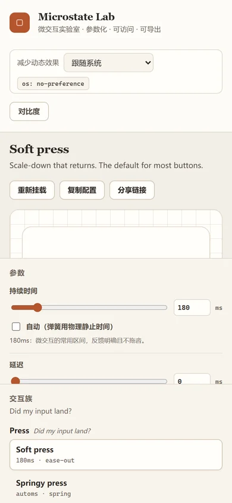

# microstate-lab

A micro-interaction laboratory for the web. Seven interaction families, each with tunable duration, easing, delay and trigger — previewed live against real components, then exported as standalone code.

**Everything the preview shows, the export reproduces.** Both are driven by the same motion plan, and a browser test loads each exported file and drives it for real.

**[Open the lab →](https://llinok111.github.io/microstate-lab/)**



> Built as a re-architecture of [webkul/micron](https://github.com/webkul/micron) (2.3k ★, MIT, unmaintained since 2018). Upstream ships twelve one-shot click keyframes; this project keeps that history and replaces the substance: a state-machine motion core, parameterised easing, accessibility as a first-class concern, and a four-target exporter. See [NOTICE](NOTICE) for the precise scope of the derivative work.

---

## Why a second look at micro-interactions

A micro-interaction is not a decoration. Each one answers exactly one question:

| Family | Question it answers | Fails when |
|---|---|---|
| **Press** | Did my input land? | Feedback arrives on release instead of press |
| **Loading** | Is the system working? | It blocks input, or shows a spinner where progress is known |
| **Submit success** | Did the operation complete? | The confirmation is only a colour change |
| **Error feedback** | What went wrong? | It is a red shake with no message, or no focus move |
| **Expand / collapse** | What is inside this container? | The panel is `display:none`d before it can animate out |
| **Drag** | Where can this go? | It has no keyboard equivalent (WCAG 2.5.7) |
| **State toggle** | Which state am I in? | It is a styled `div` with no `role` and no `aria-checked` |

The lab exists to make those distinctions visible and measurable, not to collect easing curves.



*One tile per family, captured from the running page at 2x. Only the component changes between tiles — the stage around it is identical, so the comparison is fair.*

### The same interaction, four states



*Motion is the subject, so a still is a poor test of it. Left to right: collapsed, mid-flight (the 110 ms frame, not the settled one), switch off, switch on.*

---

## Quick start

Two ways in. The first needs no JavaScript at all.

```html
<link rel="stylesheet" href="dist/microstate.css">
<script type="module" src="dist/microstate-auto.js"></script>

<button data-ms="press" data-ms-duration="180" data-ms-easing="ease-out">Continue</button>
<button data-ms="switch" data-ms-persist="autosave">Auto-save</button>
<button data-ms="async-button" data-ms-action="save">Save changes</button>
```

```js
import { registerAction } from "dist/microstate-auto.js";
// The component owns busy / success / error and the ARIA; you own the request.
registerAction("save", () => fetch("/api/save", { method: "POST" }));
```

Everything marked `data-ms` is mounted, including nodes added later. Or use the programmatic API when you need the handles:

```bash
npm install
npm run build          # dist/ + mirrored bundles into demo/
```

Then open `demo/index.html` — directly from the filesystem works, no server required.

| Command | What it runs |
|---|---|
| `npm test` | 94 unit tests: easing maths, motion plans, exports, stylesheet coverage, preferences |
| `npm run test:browser` | 87 browser tests: real pointer/keyboard/touch, a11y audit, export runtime, declarative runtime |
| `npm run build -- --report` | Bundle sizes and gzip deltas |
| `npm run figures` | Regenerate the README images from the running page |
| `npm run figures:check` | Re-verify them: dimensions, ink coverage, per-tile content |
| `npm run cli -- list` | Presets with their resolved timings |
| `npm run cli -- css press-soft -o out.css` | Generate a stylesheet from the command line |
| `npm run pack` | Release ZIP (no `node_modules`, no git) |

The figures are generated, not drawn — `scripts/figures.mjs` drives the real demo at 2x and crops to the measured content box. `figures:check` exists because the first version of that script painted a rounded-rect *over* every tile and produced six blank images that the aggregate ink statistic happily passed; the check now extracts each cell of each collage and fails if a tile has no picture in it.

---

## What changed in v0.2



*`demo/declarative.html`, captured from the running page. The only script is the runtime — there is no `mountPress()` call anywhere in it, and the consumer's own `class` survives on the mounted control.*

v0.1 answered "what should this interaction feel like". v0.2 answers "how does this get into a page without rewriting it". Each item below closes a limitation that `docs/LIMITS.md` had listed against the previous version.

| | v0.1 | v0.2 |
|---|---|---|
| Using it | Call `mountPress(el, …)` per element | `data-ms` attributes, or `<ms-button>` |
| Nodes added later | Re-scan by hand | `MutationObserver`, coalesced to one frame |
| Async request | Simulated timer only | `registerAction()` — the page owns the I/O |
| Reduced motion | OS setting only | OS setting **+** a stored preference that can only add restraint |
| Switch state | In memory | Opt-in `data-ms-persist`, survives reload |
| Spring duration | A slider that rescaled the physics | `duration: "auto"` = the settle time; pinning it is reported as a rescaling |
| Touch drag | `touch-action: none`, fought the scroll | Long-press to arm, `pan-y`, edge auto-scroll |
| Export | One preset per file | `exportBundle()` + a CLI (`bundle config.json`) |
| Sharing a config | Copy JSON | Deep link: the URL *is* the config |

---

## Using the components

The library is framework-free: each component is a function that builds DOM and returns a handle.

```js
import { mountPress, mountDisclosure } from "./dist/microstate.js";
import "./dist/microstate.css";

const press = mountPress(document.querySelector("#slot"), {
  label: "Continue",
  motion: { duration: 180, easing: "ease-out", reduced: "instant", trigger: "press" },
});

// Later: change the motion without remounting.
press.setMotion({ duration: 420, easing: "spring(1, 300, 16)" });

press.getState();   // { count, pressed, plan }
press.destroy();    // removes nodes and listeners
```

Every component exposes the same surface: `setMotion(spec)`, `getState()`, `destroy()`.

---

## The four knobs

### Duration

`0`–`4000 ms`. Below ~100 ms the transition is imperceptible; above ~400 ms a *feedback* interaction reads as lag rather than polish. The lab states this per value instead of leaving you to guess.

### Easing

Accepted forms — all four are first-class, not special cases:

```js
"ease-out"                        // CSS keyword, exported verbatim
"cubic-bezier(.2, .8, .2, 1)"     // solved per frame, Newton + bisection fallback
"spring(1, 300, 16)"              // mass, stiffness, damping
"steps(4)"  "steps(6, start)"     // quantised progress
```

A spring has no closed-form inverse, so CSS cannot express it directly. The exporter samples it into `linear()` — 32 points by default — and the curve plot shows the same samples, which is why the preview and the export cannot drift apart.



*The panel for a spring preset. The note under the curve reports the damping ratio and the derived settle time, because a spring's duration is a consequence of its physics, not a knob.*

### Delay

`0`–`2000 ms`, with one hard rule enforced by the notes panel: **delay on feedback reads as breakage**. A 120 ms delay between your click and the button responding is not polish, it is a bug the user experiences as "the app is slow". Delay belongs on entrances and toasts.

### Trigger

`press` · `click` · `hover` · `focus` · `enter` · `manual`.

`press` is the one that matters and the one CSS cannot express. A class toggle has no "held" state, so the exporter says so in a comment rather than silently generating something that does not work.

---

## Reduced motion is a decision, not a speed

The library exposes four strategies because "just make it faster" is the wrong answer for half the cases:

| Strategy | What happens | Correct for |
|---|---|---|
| `instant` | State changes immediately, transition removed | Press, toggle — the state is already legible |
| `fade` | Spatial movement dropped, 90 ms opacity remains | Reveal/collapse — something must signal the change |
| `off` | Nothing animates | Decorative flourishes that carry no state |
| `ignore` | Animates normally | Lab inspection only; documented, never silent |

Two enforcement points:

1. **CSS**: each exported stylesheet carries a real `@media (prefers-reduced-motion: reduce)` block matching the chosen strategy.
2. **JS**: `plan()` resolves the strategy at play time, and a zero-duration plan *applies the end state synchronously* — so a reduced-motion user sees the same correct state, just without the transition.

`test/a11y.test.mjs` drives this with `page.emulateMedia({ reducedMotion: "reduce" })`, which changes the actual media query the page sees, so both paths are exercised rather than a mock flag.

---

## Export

Four targets, all generated from the same plan:

**CSS** — a standalone stylesheet plus the class to add. No JS, no runtime, 3 KB typical.

```css
@keyframes ms-press-soft-anim {
  0%   { transform: scale(1); }
  35%  { transform: scale(0.97); }
  100% { transform: scale(1); }
}

.ms-press-soft { animation-duration: 180ms; /* … */ }
@media (prefers-reduced-motion: reduce) { /* … */ }
```

**JS (WAAPI)** — for effects that need runtime values (measured height, drag distance, spring settle time). Applies the end state on cancel, so an interrupted interaction never leaves the element mid-scale.

**Standalone HTML** — a complete page that runs from `file://`, honours reduced motion, and handles Enter/Space.

**Config JSON** — round-trips back into the lab.



*The export panel, with the caveats the generator attaches to the current preset — reduced-motion strategy, spring approximation, delay warnings, and a flag on counter-examples.*

`test/export-runtime.test.mjs` writes each export to a temp file, loads it in Chrome, clicks it, and asserts an animation actually ran with the expected duration — 11 assertions that the export is not just syntactically plausible.

### Export limits, stated honestly

- **Only `transform` and `opacity` are animated.** Both stay on the compositor; animating layout properties is the single most common cause of janky micro-interactions, so the exporter refuses to emit them.
- **`linear()` support** is probed with `CSS.supports`. Without it, a spring degrades to a `cubic-bezier` approximation and the output says so.
- **`will-change` is scoped.** Set while running, cleared at rest — a permanent `will-change` pins a compositor layer per element.
- **Press-in-CSS is incomplete by construction.** The export includes the four-line JS and a comment explaining why.

---

## Architecture

```
src/
  core/
    easing.js     curve maths: bezier solver, springs, steps, linear() serialisation
    motion.js     plan() / play(): clamping, reduced-motion resolution, end-state guarantee
    presets.js    21 presets across 7 families, as data
    export.js     CSS / JS / HTML / JSON generation from the same plan
  components/
    base.js       element factory, shared live region, motion holder
    press.js      press feedback, pointer + keyboard parity
    async-button.js  idle → loading → success | error → idle
    loading.js    spinner, staggered dots, determinate bar
    submit-success.js form → confirmation, focus management
    disclosure.js measured-height expand/collapse
    switch.js     role="switch" state toggle
    drag-sort.js  pointer drag + keyboard grab/move/drop
    feedback.js   inline error field + toast
  styles/microstate.css   9 KB, ships to consumers
demo/                     the lab (lab.css is workbench chrome, not shipped)
test/                     141 tests across 7 suites
```

### Three decisions worth knowing

**One easing evaluator, three consumers.** The curve plot, the preview and the exporter all call the same function. Two implementations would eventually disagree, and the disagreement would be invisible until a designer compared two screenshots.

**`plan()` is data, `play()` is the only side effect.** Everything that decides *what* will happen is pure and testable without a DOM; 24 unit tests cover the plan logic with no browser. `play()` is then a thin, auditable wrapper with one guarantee: the end state is always applied.

**The end-state guarantee is the whole point.** `animation.cancel()` removes `fill: both`, which leaves the element at whatever frame it had reached. A button stuck at `scale(0.97)` after a double-click is the canonical micro-interaction bug; `play()` writes the final keyframe on cancel, and a browser test clicks five times rapidly and asserts the computed transform is identity.

---

## Accessibility

These are tested, not aspirational:

- Every control has an accessible name (`aria-label` or a `<label for>`); asserted by scanning the live DOM.
- Everything is reachable and operable by keyboard; a test tabs through 70 stops and asserts each one shows a visible focus ring, arriving via the keyboard so `:focus-visible` actually matches.
- The shared live region is polite for success and assertive for errors, and clears itself so a repeated message is re-announced.
- Errors set `aria-invalid`, link the message with `aria-describedby`, and move focus to the field.
- The disclosure hides the panel only *after* the exit animation, so content does not vanish before it can be seen leaving.
- Drag has a full keyboard path (`Space` grab → `↓` move → `Space` drop, `Escape` cancel) with live-region announcements, and focus stays on the moved item so moves can be chained.
- Body text meets 4.5:1 contrast — this caught a real failure: the muted grey measured 2.8:1 and was darkened to `#6f6459` (5.68:1).
- A high-contrast mode doubles every border to 2px.

`docs/LIMITS.md` records what is *not* solved, including the one known limitation: animating `height` for the disclosure triggers layout on every frame, which is acceptable for a panel that opens a few times per session and unacceptable for anything animated continuously.

---

## Counter-examples

Two presets exist to be wrong, and are badged as such:

- **`error-slow-shake`** — a 600 ms shake with a 120 ms delay. Slow enough to feel punitive, delayed enough to look broken.
- **`toggle-delayed`** — an 80 ms delay on a toggle. Demonstrates how quickly delay destroys perceived responsiveness.

They are included because a lab that only demonstrates the good path teaches nothing about the boundary.

---

## Works on a phone



*At 390 px the columns reorder — stage first, controls, then the gallery — and the three-across facts row becomes a stack. Interactions are pointer/touch driven with the same reduced-motion handling.*

---

## Test coverage

| Suite | Tests | What it proves |
|---|---|---|
| `easing.test.mjs` | 21 | Bezier solving is accurate, springs settle correctly, `linear()` shape |
| `motion.test.mjs` | 24 | Reduced-motion strategies, clamping honesty, keyframe validity |
| `export.test.mjs` | 26 | Generated CSS parses and matches the plan, all targets well-formed |
| `styles.test.mjs` | 3 | No class used without a rule, no dead rules, balanced braces |
| `preferences.test.mjs` | 20 | The OS always beats a stored preference; spring duration; bundle export |
| `browser.test.mjs` | 41 | Real pointer/keyboard interaction, async state machine, drag, export panel |
| `a11y.test.mjs` | 17 | Real OS reduce, ARIA tree, focus rings via keyboard, contrast |
| `export-runtime.test.mjs` | 11 | Exported HTML loads in Chrome and animates when clicked |
| `runtime.test.mjs` | 18 | Declarative mounting, no nested buttons, observer, touch long-press |

181 tests total. The v0.2 suites are adversarial by design: the runtime tests exist
because the first implementation nested `<button>` inside `<button>`, and the
preference tests iterate every stored value against an OS reduce to prove none of
them can lift it.

---

## Credits

- Upstream: [webkul/micron](https://github.com/webkul/micron) — MIT, © 2018 Webkul. Commit history preserved.
- Easing vocabulary and naming informed by [easings.net](https://easings.net) (Andrey Sitnik, Ivan Solovev).
- Spring physics follow the standard damped harmonic oscillator; see `docs/DESIGN.md`.

## License

MIT. See [LICENSE](LICENSE) and [NOTICE](NOTICE).
